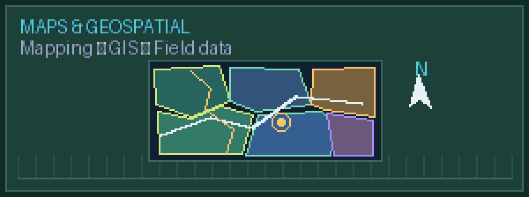
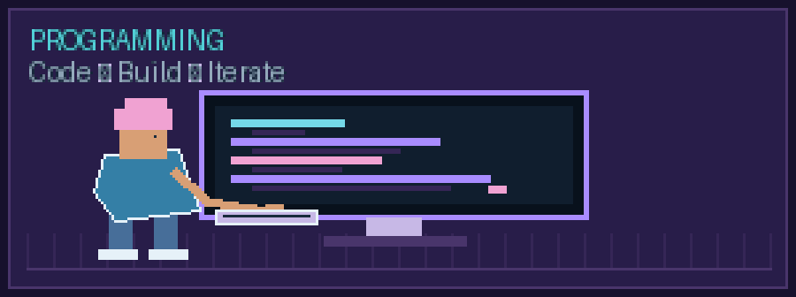
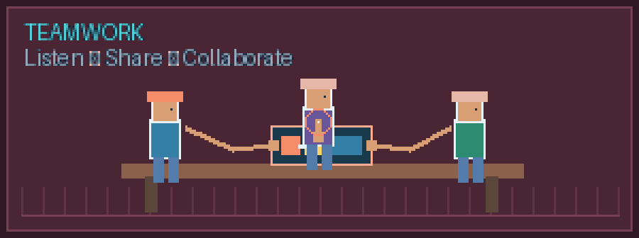
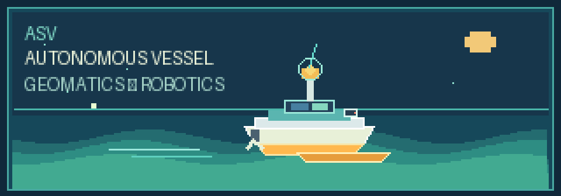

# Hi, I’m Yudhistiro Harimurti Puspoyo 👋

### Geomatics Engineering Student at ITS | Programming & Web Development

I’m a Geomatics Engineering student at **Sepuluh Nopember Institute of Technology (ITS)** with an interest in technology, web development, and geospatial data. I enjoy learning through hands-on projects, collaborating with others, and building useful solutions.

  

I’m currently an **intern at Barunastra**, in the **Programming Division**, **Web Development Subdivision**.

- 🌱 Currently developing my skills in **web development** and **programming**
- 🗺️ Interested in **geospatial technology**, mapping, and data processing
- 🧰 Familiar with **QGIS**, **ArcGIS**, and **Python** at a basic to intermediate level
- 🤝 Enjoy teamwork, research, and organizing activities
- 📍 Situbondo, East Java, Indonesia

  

## Skills

  
  

  
  

## What I’m learning

I’m currently strengthening my skills in programming and web development through my internship at Barunastra, where I’m part of the Programming Division’s Web Development Subdivision. Alongside my internship, I continue learning independently and applying what I learn to practical projects. I’m especially interested in exploring how software and geospatial technologies can work together to support mapping, data visualization, and real-world applications.

  

## Get in touch

- **Email:** [yudhist0170@gmail.com](mailto:yudhist0170@gmail.com)
- **LinkedIn:** [Yudhistiro Harimurti Puspoyo](https://www.linkedin.com/)

> Replace the LinkedIn link above with your profile’s URL. Add links to your featured repositories here as you publish projects.

