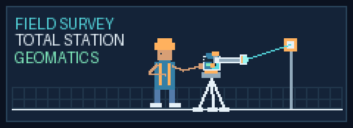
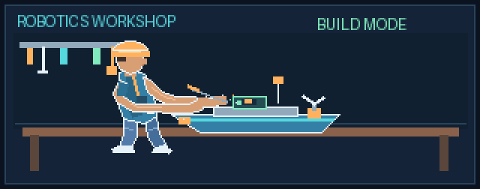

# Hi, I’m Yudhistiro Harimurti Puspoyo 👋

### Geomatics Engineering Student at ITS | Programming & Web Development

I’m a Geomatics Engineering student at **Sepuluh Nopember Institute of Technology (ITS)** with an interest in technology, web development, and geospatial data. I enjoy learning through hands-on projects, collaborating with others, and building useful solutions.

  

I’m currently an **intern at Barunastra**, in the **Programming Division**, **Web Development Subdivision**.

- 🌱 Currently developing my skills in **web development** and **programming**
- 🗺️ Interested in **geospatial technology**, mapping, and data processing
- 🧰 Familiar with **QGIS**, **ArcGIS**, and **Python** at a basic to intermediate level
- 🤝 Enjoy teamwork, research, and organizing activities
- 📍 Situbondo, East Java, Indonesia

  

## Skills

**Technical skills**

- QGIS — intermediate
- ArcGIS — basic
- Python — basic programming and data processing
- Microsoft Word, Excel, and PowerPoint
- Research, basic cartography, and copywriting

**Soft skills**

- Teamwork
- Communication and public speaking
- Problem-solving
- Time management
- Adaptability

## What I’m learning

I’m currently building my skills in **programming** and **web development** through my internship at Barunastra and independent learning. I’m also interested in exploring how technology can support geospatial applications.

  

## Selected achievements

- 1st Place, National Level Quiz Competition, AGAIN-ION, University of Muhammadiyah Jember (2026)
- Selected for the national proposal stage of the Indonesian Student Research Olympiad (OPSI) (2026)
- 6th Place, Situbondo Regency Mathematics Science Olympiad (2025)

## Get in touch

- **Email:** [yudhist0170@gmail.com](mailto:yudhist0170@gmail.com)
- **LinkedIn:** [Yudhistiro Harimurti Puspoyo](https://www.linkedin.com/)

> Replace the LinkedIn link above with your profile’s URL. Add links to your featured repositories here as you publish projects.

